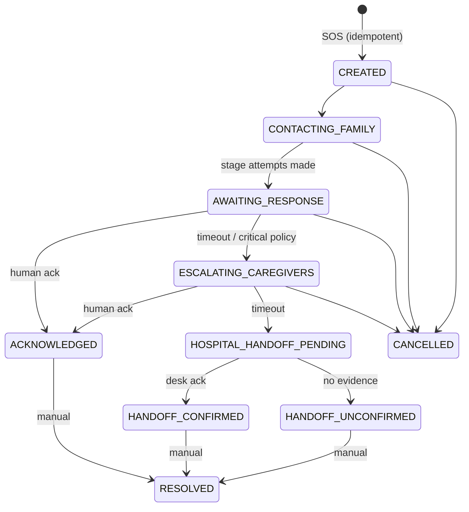
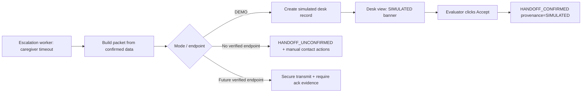
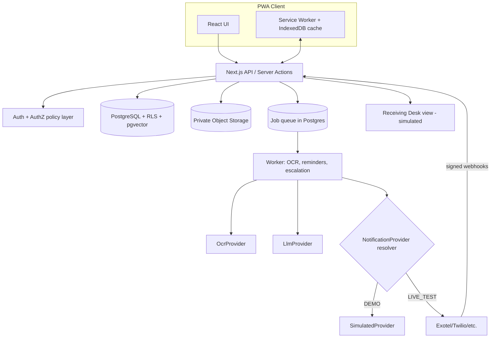
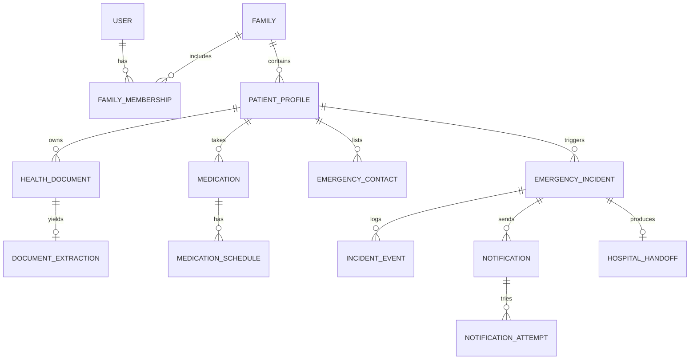
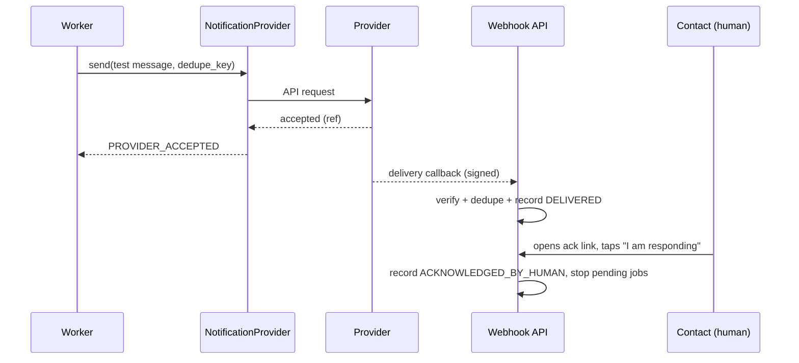
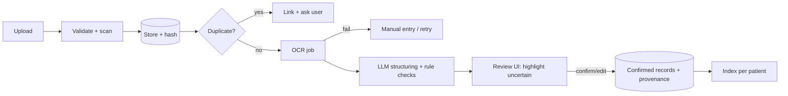
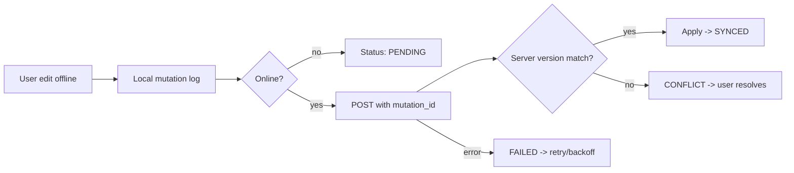

# Sanjivni — Product Requirements Document & Implementation Blueprint
**AI-Powered Personal Health Memory, Family Care & Emergency Response Platform (India-first)**

| Field | Value |
|---|---|
| Product name | **Sanjivni** (selected; replaces working name "Health Memory Agent") |
| Document version | 1.0 (pre-implementation blueprint) |
| Date | 21 October 2026 |
| Target uses | Hackathon, live demo, incubation, funding conversations |
| Status | No existing repository was provided. Architecture is therefore greenfield. If a repo exists, run the audit in §16.6 before building. |

> **Honesty convention used throughout this document**
> Every capability is tagged **[WORKING]** (must function end-to-end in the MVP), **[SIMULATED]** (runs real server state transitions but touches no external party), **[LIVE-TEST]** (real provider call to a consenting, allowlisted person), or **[FUTURE]** (not built; depends on partnerships, validation or regulation). Nothing may be described as working in the UI, pitch or README unless an automated or recorded manual test proves it.

---

## 1. Executive Summary

Indian families keep medical history scattered across paper files, WhatsApp, email and lab portals. During a doctor visit or emergency, the right report or allergy is hard to find, and family caregivers cannot tell whether an elderly parent took their medicines or saw an alert.

**Sanjivni** is a permission-controlled "health memory" for each family member. It:
1. Ingests prescriptions and reports (photo/PDF) → OCR → AI structuring → **human review** → searchable timeline.
2. Answers questions from saved records with **source-document citations**, never diagnosing.
3. Manages medication schedules, appointments and caregiver acknowledgements.
4. Produces a user-authorized, doctor-ready PDF summary.
5. Provides a **working, server-controlled SOS workflow**: SOS → family alerts → response tracking → caregiver escalation → hospital handoff.

The central design decision for a credible funding demo is the **two-mode architecture**:
- **Demo Simulation Mode (default):** the whole emergency flow runs with synthetic people and a fictional hospital, using real persisted state changes, no outbound traffic.
- **Live Test Mode:** a real SMS and/or voice call to a verified, consenting, allowlisted team member, clearly labelled as a test.
- The hospital handoff is **always labelled simulated** unless a real authorized integration exists.

Sanjivni does not diagnose, prescribe, change doses, call 112, or claim a hospital was notified.

---

## 2. Product Vision and Value Proposition

**Vision:** Every individual has an organized, searchable, permission-controlled health memory that stays useful for life.

**Value proposition by audience**

| Audience | Value |
|---|---|
| Individual / parent | Find any past report in seconds; prepare for doctor visits |
| Adult child caregiver | See reminder acknowledgements for parents; get escalation alerts |
| Elderly user | Large-button interface, simple reminders, one-tap SOS |
| Doctor | Receives a concise, patient-authorized summary with source references |
| Funders / incubators | A transparent working prototype with a defined path to partnerships |

**What Sanjivni does not promise:** fewer repeat tests (that is the clinician's decision), emergency dispatch, clinical decision support, or government-integrated records.

---

## 3. Problem Validation, Assumptions and Limitations

### 3.1 Problem hypotheses (to be validated, not assumed true)
| ID | Hypothesis | Validation method |
|---|---|---|
| H1 | Families struggle to locate prior reports at consultations | 15–20 structured interviews; time-to-find task test |
| H2 | Adult children lack visibility into elderly medication adherence | Interviews with caregivers of 60+ parents |
| H3 | Families would use an SOS that alerts relatives in sequence | Prototype usability test |
| H4 | Photo-based capture is acceptable vs. manual entry | Upload-to-confirm completion rate in pilot |

### 3.2 Assumptions (A) requiring validation
- A1: Small team (2–5), ~6–10 weeks to demo. A2: Web PWA first; no native app. A3: Pilot users are consenting friends/family. A4: An SMS/voice provider account can be provisioned in time (otherwise Demo Mode carries the demo). A5: Cloud OCR/LLM use with consented data is acceptable for the pilot, with synthetic data for public demos. A6: No real hospital partner exists.

### 3.3 Limitations (stated in-product)
- OCR and AI output can be wrong; handwritten prescriptions are high-uncertainty.
- Web apps cannot guarantee background notifications on all devices.
- Provider acceptance ≠ delivery ≠ human acknowledgement.
- The app is not a medical device and offers no clinical advice.

---

## 4. Existing Alternatives and Differentiation

| Alternative | Strength | Gap Sanjivni targets |
|---|---|---|
| ABHA / ABDM-linked apps (e.g. PHR apps) | Government-backed identity and record linking | Heavy onboarding; limited family caregiving and escalation UX |
| Hospital/lab portals (Apollo, Practo, lab apps) | Records from one provider | Fragmented; no unified family view |
| Medication reminder apps | Reminders | No document memory, no source-cited Q&A, weak caregiver loop |
| WhatsApp / Google Drive folders | Free, familiar | Unstructured, unsearchable, no consent controls |
| Personal safety/SOS apps | One-tap alerts | No health context packet, no medical timeline |

**Differentiators:** (1) review-gated OCR with provenance; (2) source-cited retrieval constrained per patient; (3) transparent, state-machine-driven escalation with honest status semantics; (4) two-mode demo architecture; (5) India-first (multi-language roadmap, DPDP-aware design).

*Note: competitor features change; verify the table before external use.*

---

## 5. Target Users and Personas

| Persona | Profile | Tech literacy | Goals | Pain points | Permissions |
|---|---|---|---|---|---|
| **Meera, 38, Family Admin** | Working parent in a metro; manages kids and her parents' records | High | Organized records, doctor-visit prep | Reports scattered; parents forget medicines | Full admin of family workspace |
| **Ramesh, 68, Elderly User** | Retired, diabetic, hypertensive; basic smartphone | Low | Simple reminders, easy help button | Small text, many apps | Own profile; can grant/revoke caregivers |
| **Anil, 42, Remote Caregiver** | Son living in another city | Medium | Know if father acknowledged meds/SOS | No visibility | Caregiver on specific profiles only |
| **Dr. Sharma, 50, Clinician** | General physician | Medium | Quick relevant history | Patients arrive without records | Time-limited read-only summary link |
| **Priya, 29, Guardian** | Parent of a 4-year-old | High | Vaccination and illness history | Paper vaccination cards | Guardian of child profile |
| **Suresh, 55, Community Volunteer** | Apartment society member | Medium | Help neighbors | No coordination tool | Community only; zero default access to medical data [FUTURE] |
| **Evaluator / Judge** | Hackathon or investor reviewer | Medium | See it work, verify honesty | Fake demos | Demo Controls role (non-production) |

---

## 6. Product Goals and Non-Goals

### Goals
G1 Organized profile per family member. G2 OCR→structured→confirmed records. G3 Source-cited Q&A. G4 Medication and appointment tracking with caregiver loop. G5 Doctor-ready summary. G6 Working SOS escalation (demo + live test). G7 Privacy-conscious architecture. G8 Repeatable, testable MVP.

### Non-goals (MVP)
Diagnosis, treatment advice, dose recommendations; real ambulance dispatch or 112 calls; real hospital integration; ABHA/ABDM integration; payments; native mobile apps; automatic clinical criticality classification of real patients; insurance workflows; telemedicine.

### Measurable success criteria (MVP)
| Metric | Target (not yet measured) |
|---|---|
| P0 automated E2E scenarios passing | 8 of 8 SOS tests + core record tests |
| Upload → confirmed record, median time | ≤ 3 min per document in usability test |
| Source-cited answer accuracy on 50-question test set | ≥ 90% correct with correct citation; 0 cross-patient leaks |
| Duplicate incidents/outbound messages in idempotency tests | 0 |
| Demo completion time (full script) | ≤ 12 min |
| Demo reset to clean state | ≤ 10 s, repeatable 20×  |

---

## 7. Feature Matrix (P0 / P1 / P2)

| Priority | Feature | Depends on | Release criterion |
|---|---|---|---|
| **P0** | Auth + family workspace + patient profiles + health ID | — | Isolation tests pass |
| P0 | Document upload, storage, OCR, review/confirm | Auth, storage | Review-gate enforced; provenance stored |
| P0 | Timeline + search | Confirmed records | Retrieval by type/date/text |
| P0 | Source-cited Health Memory chat | Indexed confirmed records | Eval set passes; citations clickable |
| P0 | Medication schedules + reminders + acknowledgement | Confirmed meds | Idempotent reminders; status states |
| P0 | Appointments | Profiles | CRUD + reminders |
| P0 | Doctor-ready PDF + expiring share link | Records, consent | Revocable; audited |
| P0 | Consent + authorization matrix | Auth | Authz tests pass |
| P0 | SOS state machine + durable worker | DB, job runner | Tests 1–8 pass |
| P0 | Demo Mode + synthetic data + Demo Controls + Reset | State machine | Works with zero credentials |
| P0 | Live Test Mode + allowlist + one real SMS or call | Provider account | Test 3 passes when configured |
| P0 | Simulated hospital receiving desk | Handoff model | Labelled simulation; packet verified |
| P0 | Basic offline (cached summary + emergency card) | PWA | Works in airplane mode |
| P1 | Full offline sync + conflict resolution | P0 offline | Sync tests |
| P1 | Lab trend graphs, emergency health card export, more languages (Hindi, Gujarati, others) | Verified labs | Unit-consistent charts only |
| P1 | Advanced caregiver escalation config, monitoring dashboards | P0 | — |
| **P2** | Community Health Network | Moderation tooling | Abuse controls |
| P2 | Verified hospital integration, ABHA/ABDM, verified hospital directory, voice assistant | Partnerships, approvals | Out of MVP scope |

---

## 8. User Stories and Acceptance Criteria (P0 selection)

| ID | Story | Acceptance criteria |
|---|---|---|
| US-01 | As Meera, I create a family and add my father as a profile. | Profile gets unique app health ID (prefix `SNJ-`), labelled "Not an ABHA/Aadhaar ID"; current-profile banner visible on every screen. |
| US-02 | As Meera, I upload a lab report photo. | File type/size validated; stored encrypted; status moves UPLOADED→PROCESSING→NEEDS_REVIEW; failure shows retry. |
| US-03 | As Meera, I review extracted values. | Original shown beside fields; low-confidence fields highlighted; nothing enters timeline as "confirmed" until I confirm; edits logged. |
| US-04 | As Meera, I ask "last 3 hemoglobin results for my father." | Answer lists dated values with clickable source docs; says "not found" when absent; never uses another profile's data. |
| US-05 | As Anil, I see if father acknowledged his 9 am medicine. | Status: Taken / Skipped / Missed / Unconfirmed; missed alert goes to configured caregiver once (dedupe). |
| US-06 | As Meera, I create a doctor summary. | I select records; preview; confirm sharing; PDF/link has expiry, revocation, audit entry; unverified fields flagged. |
| US-07 | As Ramesh, I press SOS. | Press-and-hold (or confirm) prevents accidents; incident created once; contacts notified per policy; 10-second cancel window for false alarm. |
| US-08 | As a contact, I acknowledge an alert. | Options: Responding / Contacted patient / Help on the way / Cannot respond; recorded with time and identity; incident not marked clinically resolved. |
| US-09 | As an evaluator, I run the no-response scenario. | Timeouts progress to caregiver, then simulated hospital handoff; every transition persisted; "SIMULATED HOSPITAL HANDOFF — NO REAL HOSPITAL CONTACTED." shown. |
| US-10 | As a team member, I opt in to Live Test alerts. | Number verified by OTP; stored on backend allowlist; test message says it is a test. |

---

## 9. End-to-End User Journeys

1. **Onboarding:** register → verify email/phone → create family → add profiles → set emergency contacts and policy → grant consents.
2. **Document to memory:** upload → OCR → review → confirm → appears in timeline → searchable → citable in chat.
3. **Doctor visit:** select appointment → "Prepare summary" → pick records → preview → authorize → download/share link → link expires.
4. **Medication loop:** schedule confirmed → reminder → patient taps Taken → or no response → status Unconfirmed → caregiver notified per rule → caregiver acknowledges.
5. **SOS (family responds):** SOS → incident → family notified → contact acknowledges → incident ACKNOWLEDGED → responder or patient marks resolved.
6. **SOS (no response, demo):** SOS → primary/secondary unanswered → caregiver escalation → caregiver unanswered → hospital handoff packet → receiving desk acknowledges (simulated).
7. **Live test:** enable Live Test → preflight screen → send labelled test SMS/call to allowlisted member → acknowledge via link → continue with simulation.

---

## 10. Functional Specifications by Module

### Module A — Authentication, Families, Health IDs
- Email + phone OTP login; hashed credentials (managed auth provider recommended); session expiry, device list, revoke-all; account recovery via verified channel.
- Entities: User → FamilyMembership → Family → PatientProfile. Profiles may be *self-managed* (adult with account), *guardian-managed* (child), or *caregiver-assisted* (elderly).
- Health ID: server-generated, non-guessable (e.g. `SNJ-` + 10 Crockford base32 chars + check char), unique, immutable. Never displayed as an official ID.
- Duplicate detection: fuzzy match on name + DOB + phone within the same family; propose merge; merge is manual, reversible for 7 days via audit log, never automatic.
- Profile switcher with persistent banner "Viewing: *Name* (relationship)".
- Export (JSON + original files ZIP) and deletion with a 14-day grace period, then hard delete including storage and search index; audit stub retains only non-health metadata.
- Audit every sensitive action (view summary, share, consent change, SOS, role change, export, delete).
- ABHA/ABDM: [FUTURE] only; no claims until sandbox access and validation exist.

### Module B — Dashboard and Records
Cards: family members, upcoming appointments and reminders, recent uploads with OCR status, missed/unacknowledged reminders, pending escalations, emergency health-card access, online/sync indicator, quick actions (SOS, upload, summary, reminders). Categories as in the brief (prescriptions, labs, imaging, discharge, hospitalization, conditions, allergies, vaccinations, surgeries, medications, doctors/hospitals, appointments, other). Timeline is chronological with filters; original document preserved beside extracted data.

### Module C — OCR and Extraction (see §18)

### Module D — Health Memory Chat (see §18)

### Module E — Medication Management
- Fields: name, strength, dose, route, frequency, timing, start/end, source document, confirmation status.
- Schedules created from prescriptions require explicit user confirmation.
- Status per scheduled dose: SCHEDULED → REMINDED → TAKEN | SKIPPED | MISSED | UNCONFIRMED; MISSED only after configurable grace window.
- Caregiver rule example: notify after 2 consecutive UNCONFIRMED doses (configurable).
- Edit history with who/when/why; only authorized roles edit.
- No missed-dose advice. Message: "Please ask your doctor or pharmacist."
- Notification limits documented: browser push is unreliable on iOS unless installed as PWA, may be delayed by OS battery rules, and is unavailable offline; SMS/WhatsApp are fallback channels [WhatsApp is FUTURE].

### Module F — Appointments and Timeline
Appointment CRUD (doctor, facility, date/time, type, status, prep notes, linked reports). Lab trend charts only for confirmed results with identical test code and unit; mismatched units are never plotted together; no automatic diagnosis from abnormal values (show "outside printed reference range" only if the range is printed on the source).

### Module G — Doctor-Ready Summary
Sections per brief, user-selected. Header: "Generated by Sanjivni on *date* from user-selected records. Not a clinical assessment." Each item shows source doc and verification state (Confirmed by user / Unverified). Historical medications labelled "Documented on *date*", not "current," unless the user marked active. Share link: random 256-bit token, expiry (default 48 h), optional passcode, revocable, view/download audited.

---

## 11. Complete SOS Workflow and State Machine

### 11.1 Principles
- Server authoritative; deadlines persisted as `next_action_at`; worker polls/dispatches durable jobs; no browser timers decide anything.
- SOS never waits for AI. The health packet is assembled from already-confirmed data.
- Every transition: guarded, idempotent, audit-logged, with `provenance = SIMULATED | LIVE_TEST | LIVE` (LIVE reserved for future production).

### 11.2 States
| State | Meaning | Entry condition |
|---|---|---|
| CREATED | Incident row exists | SOS accepted; idempotency key unique per patient within 60 s window and no open incident |
| CONTACTING_FAMILY | Alerts to Tier 1/2 contacts dispatching | Policy loaded; ≥1 eligible contact |
| AWAITING_RESPONSE | Waiting for human acknowledgement until `deadline` | All stage notifications attempted (any outcome) |
| ACKNOWLEDGED | ≥1 authorized human acknowledged | Valid ack; stops pending escalation jobs per policy |
| ESCALATING_CAREGIVERS | Tier 3 caregivers contacted | Family timeout elapsed without ack, or critical flag policy |
| HOSPITAL_HANDOFF_PENDING | Packet prepared for receiving desk | Caregiver timeout elapsed without ack, and scenario policy permits handoff |
| HANDOFF_CONFIRMED | Receiving desk acknowledged (SIMULATED in demo; requires real evidence otherwise) | Desk ack event |
| HANDOFF_UNCONFIRMED | No evidence of receipt | Handoff timeout, or no verified endpoint |
| RESOLVED | Closed by an authorized human with a stated reason | Manual resolution |
| CANCELLED | False alarm by patient/authorized user | Cancel within allowed window or with authorization |

Allowed transitions: CREATED→CONTACTING_FAMILY→AWAITING_RESPONSE→{ACKNOWLEDGED | ESCALATING_CAREGIVERS}; ESCALATING_CAREGIVERS→{ACKNOWLEDGED | HOSPITAL_HANDOFF_PENDING}; HOSPITAL_HANDOFF_PENDING→{HANDOFF_CONFIRMED | HANDOFF_UNCONFIRMED}; any open state→CANCELLED; ACKNOWLEDGED/HANDOFF_*→RESOLVED. Acknowledgement after handoff is recorded as an event but does not retract the handoff; the incident remains open until a human resolves it.

### 11.3 Notification and acknowledgement status vocabulary
`QUEUED → PROVIDER_ACCEPTED → DELIVERED (only with provider evidence) → CALL_ANSWERED/COMPLETED (voice, with evidence) → ACKNOWLEDGED_BY_HUMAN`; terminal alternates: `FAILED`, `UNKNOWN`, `SIMULATED`. A delivery report is never shown as acknowledgement.

### 11.4 Contact policy
Tiers: Tier 1 primary family, Tier 2 secondary family, Tier 3 caregiver/escalation. Mode per tier: sequential or parallel. Configurable per policy: per-tier timeout, retries (max attempts, backoff), rate limits, stop conditions (ack, cancel, resolve), critical-scenario escalation flag.

| Setting | Demo default | Live-test default | Pilot default (illustrative) |
|---|---|---|---|
| Tier 1 timeout | 8 s | 60 s | 120 s |
| Tier 2 timeout | 8 s | 60 s | 120 s |
| Caregiver timeout | 8 s | 60 s | 180 s |
| Handoff timeout | 8 s | 60 s | 300 s |

Production timeouts require clinical/operational review; those numbers are placeholders, not recommendations.

### 11.5 Location
Requested via browser Geolocation only after permission; record `location_status` = GRANTED_OBTAINED | DENIED | UNAVAILABLE | TIMED_OUT. SOS proceeds without location. Location is shared only with contacts the policy authorizes and with the receiving desk in the packet when the patient consented in the emergency policy.

### 11.6 Critical Patient Demo
Synthetic profile "Critical Patient Demo" (fictional name, fictional contacts using reserved non-dialable numbers, fictional "Demo General Hospital — Receiving Desk"). Flag `demo_critical_scenario = true` with provenance `SYNTHETIC_SCENARIO_CONFIG`. This flag may trigger early escalation **only** in demo policy; the UI says "Demonstration policy — not a clinical diagnosis." No code path derives a critical flag from OCR or lab values for real patients.

---

## 12. Demo Mode vs Live Test Mode

| Aspect | Demo Simulation Mode (default) | Live Test Mode |
|---|---|---|
| Purpose | Reliable full-flow showcase | Prove real outbound comms |
| Credentials | None required | Provider credentials required |
| Recipients | Seeded fictional contacts (non-dialable) | Verified, consenting, allowlisted team members only |
| Outbound traffic | None, enforced by a `SimulatedNotificationProvider` | Real provider via `LiveNotificationProvider` |
| Hospital | Fictional desk; simulated ack | Still simulated (unless authorized partner exists) |
| Banner | "DEMO / SIMULATED" on every emergency screen | "LIVE TEST" banner + per-event TEST badge |
| Demo Controls | Available (role `evaluator`, flag `DEMO_CONTROLS_ENABLED`) | Hidden except simulating later stages on allowlisted incident |
| Event provenance | `SIMULATED` | `LIVE_TEST` |
| Reset | Yes | Never touches live provider logs |

### Architecture enforcement
- `NOTIFICATION_MODE` is server config; incidents store their own `mode` at creation and cannot change it.
- Provider resolver: `mode=DEMO → SimulatedProvider` always; `mode=LIVE_TEST → LiveProvider` **and** recipient must exist in `live_test_allowlist` with `verified_at` and `consent_at`. Any other recipient → refused and audited. Seeded fictional contacts have `is_fictional = true`, a DB constraint prevents linking them to the live allowlist.
- Hard-coded denylist: emergency numbers (112, 100, 101, 102, 108), and any number not in allowlist.
- Demo-only endpoints (`/demo/*`) return 404 unless `APP_ENV != production` or `DEMO_CONTROLS_ENABLED=true`, and require the evaluator role.
- Simulation handler: each demo control calls the same domain service as real events (e.g. `recordAcknowledgement`, `advanceStage`) with `provenance=SIMULATED`. There are no static badges; UI state is read from the DB.

### Live Test preflight screen
Shows: recipient (masked), channel, exact message text, estimated cost, "This will contact a real person. Fictional contacts will not be contacted. 112 will not be called." Requires typed confirmation "SEND TEST".

Test message (SMS): `TEST ALERT — SANJIVNI DEMONSTRATION. This is not a real emergency. Please acknowledge the test if you have agreed to participate. [link]`
Voice script: "This is a test call from the Sanjivni demonstration. This is not a real emergency. If you agreed to take part, please open the link we sent to acknowledge."

### Provider evaluation (to complete before choosing; do not assume)
Candidates: Exotel, Twilio, Kaleyra, MSG91, Gupshup, Plivo, Knowlarity. Verify: SMS and voice APIs, India DLT (TRAI) registration for SMS (entity, header, template registration — typically takes days and may block SMS), KYC/account requirements, callback event semantics and signature verification, test vs production capability, pricing, regional restrictions, rate limits. **Fallback if SMS DLT approval is delayed:** use voice call (often simpler to start) or an authenticated in-app/push alert for the live demonstration, and state which channel was used. Interface: `NotificationProvider { send(); parseCallback(); verifySignature(); }`.

---

## 13. Hospital Handoff and External Integration Boundaries

**Packet contents:** hospital/desk name, incident ID, patient identity (synthetic in demo), activation time, location + permission status, medical summary, confirmed allergies and active medications (only if present and confirmed), selected historical reports, family notification attempts, caregiver responses, escalation status, handoff-prepared timestamp, desk-acknowledged timestamp, full event timeline.

- Demo: `ReceivingDeskView` at `/desk/:incidentId` (separate role, separate layout). Desk "Accept packet" button is an evaluator/demo control creating event `HANDOFF_ACKNOWLEDGED (SIMULATED)`.
- Mandatory banner: **SIMULATED HOSPITAL HANDOFF — NO REAL HOSPITAL CONTACTED.**
- Real mode without a verified endpoint: state `HANDOFF_UNCONFIRMED` with manual actions ("Call hospital," "Call 112 yourself") — Sanjivni never places those calls.
- Packet access: tokenized, expiring, audited, minimal data.
- [FUTURE] requirements for a real handoff: signed agreement with a hospital, verified endpoint/contact, patient consent captured in advance, encrypted transmission, audit, operational runbook, clinical governance. Hospital discovery via a verified directory/maps API is a later phase; no fabricated nearby hospitals.
- Out-of-scope forever for the MVP: ambulance dispatch, calling 112.

---

## 14. UI/UX Screen Inventory and Design Direction

**Design direction:** calm, trustworthy palette (deep teal + warm white, red reserved for SOS); minimum 16 px body, 48 px touch targets, elderly mode (larger text, simplified home with 3 buttons); WCAG 2.1 AA contrast; icons + text for status, never color alone; Devanagari/Gujarati-capable fonts (Noto Sans); tone: plain, reassuring.

**Status chips:** `DEMO / SIMULATED` (amber), `LIVE TEST` (blue), `PROVIDER ACCEPTED`, `DELIVERY CONFIRMED` (only when verified), `ACKNOWLEDGED BY CONTACT` (green), `HOSPITAL HANDOFF SIMULATED` (amber), `HANDOFF UNCONFIRMED` (grey/red outline), `UNVERIFIED (OCR)`, `CONFIRMED BY YOU`.

| # | Screen | Key content / states |
|---|---|---|
| 1 | Onboarding & auth | Register, OTP, recovery, consent intro |
| 2 | Family dashboard | Cards per §10-B; offline/sync chip |
| 3 | Patient profile | Identity, health ID, emergency card, SOS button |
| 4 | Upload & OCR review | Split view: original left, fields right; uncertain fields highlighted; Confirm/Edit/Reject |
| 5 | Health timeline | Filters, document badges |
| 6 | Health Memory chat | Answers with citation chips; "not found" state |
| 7 | Medication schedule | Daily list, Taken/Skipped, history |
| 8 | Appointments | List/calendar, prep notes |
| 9 | Doctor summary builder | Select → preview → authorize → share management |
| 10 | SOS screen | Press-and-hold, 10 s cancel, location status |
| 11 | Incident timeline (emergency ops) | State, contact cards, countdown, summary preview, failures |
| 12 | Contact acknowledgement page | Tokenized link; four response buttons; identity check |
| 13 | Hospital handoff dashboard / receiving desk | Packet + banner |
| 14 | Demo control panel | Buttons listed in §15 |
| 15 | Live Test configuration | Allowlist, verify, preflight, channel |
| 16 | Consent & permissions | Per-profile grants, revocation |
| 17 | Community network [P2] | Groups, requests |
| 18 | Settings | Language, elderly mode, quiet hours, export/delete |
| 19 | Offline & sync status | Queue, conflicts, last sync |

Every major workflow specifies loading, empty, error, success and offline states; destructive/sensitive actions require explicit confirmation. Responsive: single column <640 px, two-column 640–1024 px, three-column dashboard >1024 px.

---

## 15. Emergency Dashboard and Evaluator Controls

Displays: SOS button; patient + incident ID; state; per-recipient cards (channel, status chain, timestamps, errors); chronological timeline; countdown to next escalation (computed from server `next_action_at`); family and caregiver ack state; health-packet preview; handoff status; failed/pending actions; mode banner.

**Demo Controls (evaluator role, separated visually, labelled "EVALUATOR CONTROLS — SIMULATION ONLY"):**
1. Start synthetic SOS · 2. Primary contact unanswered · 3. Family acknowledges · 4. Advance timeout · 5. Caregiver acknowledges / no response · 6. Advance to hospital handoff · 7. Receiving desk accepts packet · 8. Open receiving-desk view · 9. Reset scenario.
Each control calls a server endpoint, produces an `EmergencyIncidentEvent` with `provenance=SIMULATED` and updates the UI via realtime subscription (or polling fallback every 2 s).

---

## 16. Data Model, Architecture and Diagrams

### 16.1 Recommended stack (with fit evaluation)

| Layer | Recommendation | Why | Alternatives considered |
|---|---|---|---|
| Frontend | Next.js (App Router) + TypeScript + Tailwind, PWA | One codebase, SSR, strong ecosystem | Vite+React (simpler, no SSR), Flutter (better native offline, slower for web demo) |
| Backend | Next.js server routes + a separate **Node worker** (same repo) | Worker is required for durable escalation; serverless functions alone can't run reliable timers | NestJS (more structure, more setup) |
| DB | PostgreSQL (Supabase or managed Postgres in an Indian region, e.g. Mumbai) | Relational integrity, RLS, transactions, `FOR UPDATE SKIP LOCKED` | Firebase (weaker relational/consistency for audit) |
| Job runner | Postgres-backed queue (pg-boss or Graphile Worker) | No extra infra; durable, restart-safe | Redis+BullMQ (extra service), Temporal (overkill for MVP) |
| Storage | S3-compatible private bucket, SSE, signed URLs | Standard | Supabase Storage |
| Auth | Supabase Auth / Auth.js with OTP | Faster, secure defaults | Custom (not advised) |
| OCR | `OcrProvider` abstraction: Google Document AI / Vision, AWS Textract, or Azure Document Intelligence; Tesseract as offline-able fallback | Evaluate on 30 sample Indian prescriptions/labs before choosing | — |
| LLM | `LlmProvider` abstraction (e.g. Claude via API) with structured-output schema | Swappable | — |
| Embeddings/search | pgvector + Postgres full-text | Single datastore, filtered by patient_id | Dedicated vector DB |
| PDF | Server-side HTML→PDF (Playwright/Puppeteer) | Good Indic font support | pdf-lib |
| Observability | Sentry, structured JSON logs (PHI-scrubbed), uptime check | — | — |

Data residency: prefer an India region; confirm provider data-processing terms and whether OCR/LLM calls may retain data. For public demos use synthetic data only.

### 16.2 System architecture

### 16.3 Core entities (accepted subset)

| Entity | Key fields | Notes / indexes |
|---|---|---|
| User | id, email, phone, status | unique email/phone |
| Family | id, name, owner_id | |
| FamilyMembership | family_id, user_id, role (admin, adult, caregiver, member, evaluator) | unique (family,user) |
| PatientProfile | id, family_id, health_id, name, dob, sex, managed_by(self/guardian/caregiver), user_id?, is_synthetic, demo_critical_scenario | unique health_id; index family_id |
| CaregiverRelationship | profile_id, user_id, scope, status | |
| ConsentGrant | profile_id, grantee, purpose, scope, granted_at, revoked_at, expires_at | enforced by policy layer |
| HealthDocument | id, profile_id, type, storage_key, sha256, mime, size, status, uploaded_by, doc_date | unique (profile_id, sha256) for dup detection |
| DocumentExtraction | id, document_id, provider, raw_text, fields_json, field_confidence, status (PENDING/NEEDS_REVIEW/CONFIRMED/REJECTED), reviewed_by, reviewed_at, correction_history | |
| MedicalCondition / Allergy / LabResult / Encounter | profile_id, source_document_id, value fields, units, ref_range, verification (UNVERIFIED/USER_CONFIRMED/CLINICIAN_DOCUMENTED) | index (profile_id, test_code, date) |
| Medication / MedicationSchedule / AdherenceLog | profile_id, dosing fields, source_doc, confirmed, active flag; log has scheduled_for, status, acked_by | unique (schedule_id, scheduled_for) |
| Appointment | profile_id, datetime, facility, status | |
| Reminder | profile_id, kind, due_at, status, dedupe_key | unique dedupe_key |
| EmergencyContact | profile_id, name, phone, tier, channels, is_fictional, verified_at | |
| EmergencyPolicy | profile_id, mode config, timeouts, retries, critical_flag_policy | |
| EmergencyIncident | id, profile_id, mode (DEMO/LIVE_TEST), state, idempotency_key, started_at, next_action_at, cancelled_by, resolved_by, location_status, lat/lng?, version | partial unique: one open incident per profile; index (state, next_action_at) |
| EmergencyIncidentEvent | id, incident_id, seq, type, from_state, to_state, provenance, actor, payload, at | append-only |
| Notification / NotificationAttempt | incident_id, contact_id, channel, status, provider, provider_ref, error, dedupe_key | unique dedupe_key; unique (provider, provider_event_id) for callbacks |
| EscalationJob | incident_id, stage, run_at, status, locked_by, attempt | unique (incident_id, stage) |
| HospitalHandoff | incident_id, desk_id, packet_json, prepared_at, acked_at, provenance | |
| LiveTestRecipient | user_id, phone, otp_verified_at, consent_at, revoked_at | allowlist |
| ShareLink | document/summary ref, token_hash, expires_at, revoked_at, views | |
| SyncJob | client_id, mutation_id, payload, status | unique (client_id, mutation_id) |
| AuditLog | actor, action, subject, profile_id, result, ip, at | append-only, hash-chained optional |
| CommunityGroup / Membership / AssistanceRequest | [P2] | |

All PHI tables carry `profile_id`; row-level security and the application policy layer both check `can(user, action, profile_id)`. Deletion: soft-delete with grace, then hard delete of documents, extractions, embeddings, and storage objects.

### 16.4 Entity relationship overview

### 16.5 Offline strategy, summarized in §21.

### 16.6 Existing repo audit (if a repo appears)
Document framework, auth, DB, existing OCR/chat/reminder code; map to this PRD; reuse working parts; list gaps before coding.

---

## 17. API and Third-Party Integration Specifications

Conventions: JSON over HTTPS; auth via session cookie/JWT; `Idempotency-Key` header on mutating emergency calls; errors `{error:{code,message,details}}`; 401 unauthenticated, 403 unauthorized (audited), 404 for hidden resources, 409 conflict, 429 rate limit.

| Endpoint | Purpose | Authorization |
|---|---|---|
| `POST /api/profiles` | Create patient profile | family admin/adult |
| `POST /api/profiles/:id/documents` | Upload (multipart) | write on profile |
| `GET /api/documents/:id/extraction` | Fetch proposed fields | read on profile |
| `POST /api/documents/:id/extraction/confirm` | Confirm with edits `{fields, edits[]}` | write on profile |
| `POST /api/profiles/:id/chat` | `{question}` → `{answer, citations[{docId,date,snippet}], confidence, notFound}` | read on profile |
| `POST /api/profiles/:id/medications/:mid/schedules/confirm` | Confirm schedule | write |
| `POST /api/schedules/:sid/doses/:did/ack` | Taken/Skipped | patient or delegated caregiver |
| `POST /api/profiles/:id/summaries` | Build summary `{recordIds[]}` → preview | read + share consent |
| `POST /api/summaries/:id/share` | Create expiring link | explicit authorization step |
| `DELETE /api/share-links/:id` | Revoke | owner |
| `POST /api/sos` | Start incident `{profileId, location?}` + Idempotency-Key → `{incidentId, state, mode}` | profile owner/authorized triggerer |
| `GET /api/incidents/:id` | State + events + notifications | participants only |
| `POST /api/incidents/:id/cancel` | False alarm `{reason}` | patient/admin |
| `POST /api/incidents/:id/resolve` | `{reason}` | authorized human |
| `POST /api/ack/:token` | Contact acknowledgement `{response}` | token + identity check |
| `POST /api/webhooks/provider` | Provider callback | signature verified, replay-protected |
| `POST /api/live-test/recipients` / `.../verify` | Register/verify allowlist | team admin |
| `POST /api/live-test/send` | Preflight-confirmed send | allowlisted + live mode |
| `POST /demo/*` (`start`, `no-response`, `acknowledge`, `advance-timeout`, `handoff`, `desk-accept`, `reset`) | Demo controls | evaluator, non-prod or flag |
| `GET /desk/:incidentId` | Receiving-desk view | desk token |

**Webhook handling:** verify HMAC/signature; reject stale timestamps; insert `(provider, provider_event_id)` unique → duplicate replays return 200 and no-op; map provider status to internal vocabulary; unknown statuses → `UNKNOWN`, never `DELIVERED`.

---

## 18. AI / OCR Pipeline and Safety Controls

### 18.1 Document pipeline
1. Validate: MIME sniffing, allowed types (JPEG, PNG, HEIC→JPEG, PDF), max 15 MB, max 20 pages, malware scan (ClamAV or provider), strip EXIF GPS.
2. Store privately; compute SHA-256; exact duplicates flagged ("already uploaded on …") and linked, never silently merged; near-duplicates (same date/type/facility) flagged for user decision.
3. Queue OCR job; retries ×3 with backoff; failure → status OCR_FAILED with manual-entry option.
4. LLM structuring with strict JSON schema; each field carries `value`, `source_span`, `confidence`; instruction: "return null if not present or illegible; never infer."
5. Rule checks: units whitelist, date plausibility, patient-name mismatch warning, dose-format validation.
6. Review UI; user confirms/edits; confirmed rows tagged `USER_CONFIRMED`; clinician-documented status only means "printed in a clinician's document," not "validated by Sanjivni."
7. Index only confirmed data (plus optionally raw text flagged "unconfirmed") into per-patient search.

Handwritten prescriptions: auto-flag as HIGH_UNCERTAINTY; require field-by-field confirmation; medicine names get a "verify with the original / pharmacist" note. Cost control: cache by hash, cap pages per user/day, use cheaper OCR first.

### 18.2 Health Memory chat architecture
- Retrieval: hybrid (pgvector + full-text), **hard filter `profile_id = :selected`** applied in SQL before ranking; the model never receives other profiles' data. Authorization checked before retrieval and again before citation links are served.
- Prompt context includes records with `verification` tags and dates; answer format requires citations; post-check verifies every cited ID exists in the retrieved set; answers with unsupported claims are replaced by "I couldn't find that in the saved records."
- Behavior rules: no diagnosis/prescription/dosing; historical prescription ≠ current medication (phrase as "prescribed on [date]; marked active: yes/no"); unconfirmed OCR labelled; missing data stated plainly; summaries labelled "AI-generated from your records."
- Safety refusal template for clinical questions: redirect to doctor; for emergencies show SOS and tell the user to contact local emergency services.
- Privacy: provider contract with no-training/retention terms where possible; PHI-minimized prompts; logs store IDs not content.
- Evaluation: 50–100 question gold set across 3 synthetic families; metrics: answer correctness, citation validity, refusal correctness, cross-patient leakage (must be 0), hallucination rate (unsupported claims). Run on every prompt/model change in CI.

---

## 19. Emergency Escalation and Durable Background Processing

- On SOS, one transaction: insert incident (unique partial index → duplicate returns existing incident), insert `CREATED` event, insert `EscalationJob(stage=CONTACT_FAMILY, run_at=now)`.
- Worker claims jobs with `SELECT … FOR UPDATE SKIP LOCKED`, runs stage handler inside a transaction that re-checks the incident state and `version` (optimistic concurrency); if state moved (ack/cancel), job is a no-op.
- Notification creation uses `dedupe_key = incident:contact:channel:attempt` with a unique constraint, so retries and double job-runs cannot send twice. Provider call is made with the same key as an idempotency token where supported; crash between "send" and "record" yields `UNKNOWN` after reconciliation rather than a second blind send (policy: at-most-once for calls, at-least-once-with-dedupe for SMS, configurable).
- Timeouts: next stage job scheduled with `run_at = now + timeout`; persisted, so a restart simply resumes. Worker also runs a sweeper every 5 s for overdue jobs.
- Acks, cancels and resolves cancel pending jobs in the same transaction.
- Rate limits: per-profile SOS (e.g. 3/hour in live modes), per-number send limit, global provider budget cap.
- Provider failure: attempt → `FAILED`; retry per policy; after retries, fall to next channel/contact; the UI shows FAILED, not success. If all channels fail, incident shows "No contact reached" with manual-call guidance.
- Every transition writes an incident event and audit log entry.
- Demo timeouts are policy values (seconds); demo "Advance timeout" simply sets the next job's `run_at=now`.

---

## 20. Security, Privacy, Consent and Compliance

### 20.1 Controls
Server-side authorization on every request; RLS as defense in depth; patient-level isolation; TLS 1.2+; encryption at rest (DB, storage) with KMS-managed keys; field-level encryption for contact numbers and notes recommended; secrets only in server environment/secret manager (never client, URL, logs); PHI-scrubbed logs; rate limits and bot protection on auth/OTP/upload/SOS; secure share links (hashed tokens, expiry, revocation, audit); session invalidation on role/consent revocation; local-device protections (§21); backups encrypted, tested restore; incident response plan (triage, containment, notification of affected users and authorities as required); minimal-disclosure notifications ("Sanjivni alert about *Name* — open the app," no diagnoses); dependency scanning; pen-test checklist before pilot.

### 20.2 Authorization matrix (summary)

| Action | Self (adult) | Guardian (child profile) | Family admin | Caregiver | Member | Evaluator | Doctor link | Community member |
|---|---|---|---|---|---|---|---|---|
| View own records | ✔ | ✔ | per consent | per grant | ✘ | demo only | selected items | ✘ |
| Upload / confirm | ✔ | ✔ | per consent | per grant | ✘ | demo | ✘ | ✘ |
| Manage emergency contacts | ✔ | ✔ | ✔ | ✘ | ✘ | demo | ✘ | ✘ |
| Trigger SOS | ✔ | ✔ | ✔ | ✔ (if granted) | ✘ | demo | ✘ | ✘ |
| Acknowledge incident | contact token / role | ✔ | ✔ | ✔ | ✘ | demo | ✘ | ✘ |
| Cancel / resolve incident | ✔ | ✔ | ✔ | resolve only if granted | ✘ | demo | ✘ | ✘ |
| Share summary | ✔ | ✔ | with patient consent | ✘ | ✘ | demo | — | ✘ |
| Demo controls | ✘ | ✘ | ✘ | ✘ | ✘ | ✔ (non-prod) | ✘ | ✘ |

Adults control their own data; admins do not see an adult's records without that adult's grant. Children's profiles are guardian-managed; transition to adult control at 18 requires a workflow.

### 20.3 Regulatory considerations (verify with counsel; no compliance claim made)
| Topic | Source to consult | Practical implication |
|---|---|---|
| Digital Personal Data Protection Act, 2023 | MeitY / India Code (meity.gov.in, indiacode.nic.in) | Notice and consent, purpose limitation, data-principal rights (access, correction, erasure, grievance), breach handling |
| DPDP Rules, 2025 (notified November 2025, with phased commencement) | MeitY / Gazette (egazette.gov.in) | Check current commencement dates, verifiable parental consent for children's data, security safeguards, breach reporting; confirm status as of today |
| Children's data | DPDP Act s.9 and Rules | Guardian-managed profiles need verifiable consent; no tracking/targeted advertising of children |
| ABDM / ABHA | abdm.gov.in, sandbox.abdm.gov.in | Sandbox access and certification are prerequisites; [FUTURE] |
| Health data security guidance | MeitY, CERT-In directions (incident reporting timelines), ISO 27001 as benchmark | Maintain logs, report incidents as directed |
| SMS/voice rules | TRAI DLT framework (trai.gov.in) | Registered headers/templates for SMS |
| Telemedicine/medical device status | NMC / CDSCO guidance | Positioning as a records tool, not a medical device; revisit if adding decision support |

The team must re-check each source on the date of use; the dates above reflect knowledge as of mid-2026 and must be confirmed.

### 20.4 Data lifecycle
Retention: documents kept until the user deletes; incident audit retained X months (decide with counsel); export as ZIP/JSON; deletion cascade including search index and backups expiring by retention window; demo data separate schema/flag and purged on reset.

---

## 21. Offline-First Strategy

| Capability | Offline? | Notes |
|---|---|---|
| View cached summary & emergency card (selected profiles) | **Yes [P0]** | Pre-cached in encrypted IndexedDB (WebCrypto key derived from device PIN/biometric via WebAuthn where available) |
| Show emergency contacts + one-tap `tel:` links | **Yes [P0]** | Fallback when network is down |
| Queue medication ack / appointment edits | Yes [P1] | Mutation log with `client_id + mutation_id` for idempotent replay |
| Upload documents | Queue only [P1] | Processed after reconnect |
| AI chat, OCR, SOS notifications, escalation, PDF | **No** | UI states: "Needs internet" with fallback actions |

Sync statuses: ONLINE, OFFLINE, PENDING, SYNCED, CONFLICT, FAILED. Conflict policy: server-version check; field-level last-writer-wins for low-risk fields; medication/allergy conflicts require user resolution. Logout/profile removal wipes local cache; shared-device mode disables caching. SOS while offline: show "No connection — call your contact / 112 now" and queue the SOS to send on reconnect with a clear "not yet sent" status; never imply it was sent.

---

## 22. Testing and Quality Assurance Plan

| Level | Scope |
|---|---|
| Unit | State machine guards, authorization policies, dedupe keys, provider status mapping, dose-schedule generator, unit-safe lab comparison |
| Integration | DB transactions, worker claims, webhook signature + replay, storage access control |
| E2E (Playwright) | Tests 1–8 below, document flow, chat, summary PDF, account deletion |
| AI eval | Gold-set retrieval and citation checks (§18.2) |
| Accessibility | axe-core in CI; manual screen reader and large-text pass |
| Performance | Dashboard LCP < 2.5 s on mid-range phone over 4G; OCR job p95 < 60 s (target) |
| Security | Authz fuzzing across profiles; dependency audit; secret scan |
| Manual | Offline airplane-mode run; shared-device logout |
| Live provider | Scripted run with one consenting recipient, results logged |
| Rehearsal | Full demo script ×3 on the demo environment |
| Pilot validation | 5–10 consenting users, 2–4 weeks |

### SOS acceptance tests
| # | Test | Pass criteria |
|---|---|---|
| 1 | Family responds | One incident; contacts show SIMULATED notified; ack event recorded; state ACKNOWLEDGED; pending jobs cancelled; incident not marked resolved |
| 2 | No one responds | Tier 1/2 timeout → ESCALATING_CAREGIVERS → timeout → HOSPITAL_HANDOFF_PENDING → HANDOFF_CONFIRMED (SIMULATED); desk view shows correct synthetic packet; banner text exact; full timeline present |
| 3 | Live test | Non-allowlisted recipient rejected; allowlisted gets labelled test; provider ref stored; DELIVERED only if callback evidence; ack link recorded; fictional contacts never contacted (assert zero provider calls to them) |
| 4 | Provider failure | Induced 5xx/timeout → FAILED/UNKNOWN; retries per policy; no DELIVERED status; fallback executed |
| 5 | Duplicate protection | 10 concurrent SOS posts → 1 incident; repeated send → 1 attempt per dedupe key; replayed callback → no new event |
| 6 | Restart recovery | Kill worker mid-countdown; restart; incident advances once; no duplicate events/sends |
| 7 | Authorization | Cross-profile summary fetch → 403 + audit; non-authorized contact edit/ack/cancel → denied + audit |
| 8 | Reset | After full run, reset → initial synthetic state, event log cleared for demo incidents, rerun passes; live logs untouched |

Other required tests: OCR uncertainty highlighting; chat cites sources and returns "not found"; cross-family isolation; reminder dedupe and missed logic; PDF contents/expiry/revocation; account deletion removes files and index; signed URL expiry.

---

## 23. Success Metrics and Evaluation Plan

| Metric | Method | Target (to be measured) |
|---|---|---|
| Upload success rate | Pilot logs | ≥ 95% |
| OCR field correction rate | Reviewed fields edited / total | Record, then improve; no pre-claimed accuracy |
| Prior-report retrieval | Task test on timed scenarios | ≤ 60 s median |
| Source-answer accuracy | Gold set | ≥ 90%; 0 leaks |
| Summary generation success | Automated | ≥ 99% |
| Provider accept / delivery / failure rates | Live tests | Report observed values |
| Human ack rate (controlled) | Live tests | Report observed values |
| Duplicate incidents/notifications | Idempotency tests | 0 |
| Escalation transition correctness | State-machine tests | 100% |
| Handoff simulation success | E2E | 100% |
| Offline sync reliability | Manual + automated | Report observed values |
| Authorization failures leaking data | Security tests | 0 |
| Demo duration | Stopwatch | ≤ 12 min |

Protocol: fixed synthetic datasets, versioned test scripts, results recorded in `docs/results/` with date and commit hash. Targets are labelled "target" until measured; no medical-outcome claims.

---

## 24. Phased Implementation Roadmap

Assumes a small team; durations are estimates.

| Phase | Weeks | Objective & scope | Key tech / migrations | Acceptance / DoD |
|---|---|---|---|---|
| 0 Foundations | 1 | Repo, CI, env, auth, DB, RLS baseline, design system | users, families, profiles, audit | Login, profile isolation tests green |
| 1 Records vertical slice | 2–3 | Upload→OCR→review→timeline→search | documents, extractions, records, storage | A sample report goes end-to-end with review gate |
| 2 SOS core (demo) | 2–3 (parallel) | State machine, worker, SimulatedProvider, incident UI, demo controls, desk view, reset | incidents, events, notifications, jobs, handoff | Tests 1,2,5,6,8 pass with zero credentials |
| 3 Memory chat + meds + appointments | 2 | Retrieval with citations, schedules, reminders, appointments | embeddings, schedules, adherence | Eval set passes; reminders dedupe |
| 4 Summary + consent | 1 | PDF, share links, consent grants, authz matrix tests | share_links, consents | Test 7 passes |
| 5 Live Test Mode | 1–2 | Provider adapter, allowlist, OTP verification, webhooks, preflight | live_test_recipients | Tests 3,4 pass with a real consenting recipient |
| 6 Offline + polish | 1 | PWA, cache, emergency card, sync status, a11y, perf | service worker | Airplane-mode checklist passes |
| 7 Hardening + rehearsal | 1 | Security review, runbook, demo script ×3, docs | — | MVP Definition of Done met |
| P1/P2 | after | Per §7 | | |

Because phases 1 and 2 are independent, run them in parallel to protect the SOS demo, which is the highest-value deliverable.

---

## 25. Risk Register

| # | Risk | L | I | Mitigation | Owner |
|---|---|---|---|---|---|
| R1 | Incorrect OCR extraction | H | H | Review gate; confidence highlighting; provenance | AI/ML lead |
| R2 | Handwritten prescription ambiguity | H | H | High-uncertainty flag; mandatory verification | AI/ML lead |
| R3 | AI hallucination | M | H | Citation post-check; refusal rules; eval gate | AI/ML lead |
| R4 | Unauthorized family access | M | H | RLS + policy layer; tests; audit | Security |
| R5 | Medical information exposure | M | H | Encryption, minimal notifications, PHI-scrubbed logs | Security |
| R6 | Outdated/invalid med schedules | M | H | Confirmation, edit history, "documented on" wording | Product |
| R7 | Notification delivery failure | H | H | Multi-channel, status honesty, manual fallback | Backend |
| R8 | Duplicate calls/messages | M | H | Dedupe keys, idempotency, locks | Backend |
| R9 | Inaccurate status indicators | M | H | Single status vocabulary; evidence-only DELIVERED | Backend/QA |
| R10 | Device loss, local exposure | M | M | Encrypted cache, remote session revoke | Frontend |
| R11 | Offline sync conflicts | M | M | Versioning; user resolution for high-risk fields | Frontend |
| R12 | Wrong profile merge | L | H | Manual only, reversible, audited | Product |
| R13 | Escalation failures | M | H | Durable jobs, sweeper, restart tests | Backend |
| R14 | False confidence in emergency response | M | H | Clear disclaimers; "call 112 yourself" guidance; honest labels | Product |
| R15 | Missing hospital integrations | H | M | Simulated desk labelled; roadmap | Product |
| R16 | Third-party outage | M | M | Provider abstraction; fallback channel | Backend |
| R17 | SMS/voice restrictions (DLT, KYC) | H | M | Start registration immediately; voice/in-app fallback | Lead |
| R18 | Unexpected costs | M | M | Budget caps, caching, quotas | Lead |
| R19 | Regulatory uncertainty | M | H | Counsel review; synthetic data for demos | Lead |
| R20 | Community abuse [P2] | M | M | Opt-in, moderation, no default data sharing | Product |
| R21 | Evaluator mistakes demo for real service | M | H | Persistent mode banners; truthful pitch script | Lead |

---

## 26. Deployment, Monitoring, Backup and Recovery

- Environments: local, staging (demo with synthetic data), production-pilot (separate DB/project). Demo Mode is the default in staging; live-test config only through secrets.
- CI/CD: lint, typecheck, unit, integration, E2E, secret scan; migrations reviewed; one-click rollback.
- Hosting: web on a managed platform; worker as a long-running service (not serverless) with health endpoint and auto-restart; DB in an India region with PITR.
- Monitoring: Sentry; structured logs; alerts on worker lag (jobs overdue > 30 s), provider failure rate, webhook signature failures, auth anomalies, cost spikes.
- Backups: daily encrypted snapshots + PITR; quarterly restore drill; RPO ≤ 15 min and RTO ≤ 4 h (targets).
- Demo reset: transactional script scoped to `is_synthetic=true` rows.
- Runbook: provider outage, data breach, wrong-recipient message, demo failure fallback (pre-recorded video, clearly labelled as such).

---

## 27. Environment Variables and Credentials (names only)

| Variable | Purpose |
|---|---|
| `APP_ENV` | local / staging / production |
| `NOTIFICATION_MODE` | `DEMO` (default) or `LIVE_TEST` |
| `DEMO_CONTROLS_ENABLED` | enables `/demo/*` |
| `DATABASE_URL`, `DATABASE_POOL_URL` | Postgres |
| `AUTH_SECRET`, `SESSION_TTL` | auth |
| `STORAGE_BUCKET`, `STORAGE_ENDPOINT`, `STORAGE_ACCESS_KEY`, `STORAGE_SECRET_KEY` | object storage |
| `KMS_KEY_ID` or `FIELD_ENCRYPTION_KEY` | field encryption |
| `OCR_PROVIDER`, `OCR_API_KEY` (+ provider-specific) | OCR |
| `LLM_PROVIDER`, `LLM_API_KEY`, `LLM_MODEL` | AI |
| `NOTIFY_PROVIDER`, `NOTIFY_ACCOUNT_SID`/`API_KEY`/`API_TOKEN`, `NOTIFY_SENDER_ID`, `NOTIFY_DLT_ENTITY_ID`, `NOTIFY_DLT_TEMPLATE_ID`, `NOTIFY_VOICE_CALLER_ID` | live-test provider |
| `NOTIFY_WEBHOOK_SECRET` | callback verification |
| `PUBLIC_BASE_URL` | ack links and webhook URL |
| `SHARE_LINK_SIGNING_KEY` | share link tokens |
| `SENTRY_DSN` | monitoring |
| `LIVE_TEST_MAX_SENDS_PER_DAY`, `LIVE_TEST_BUDGET_CAP` | safety limits |

If provider variables are missing, the UI shows "Live Test not configured — see setup guide" and Demo Mode remains fully functional. Provide `.env.example` with placeholders only.

---

## 28. Funding-Demo Scripts

### Script A — Full funding demo (~12 minutes)
| Step | Action | Expected visible output |
|---|---|---|
| 1 | Open staging; banner shows DEMO / SIMULATED | Synthetic family dashboard with ≥4 members |
| 2 | Upload sample lab report for "Demo Father" | OCR → review screen with highlighted uncertain field; evaluator corrects and confirms |
| 3 | Ask chat: "Last three hemoglobin results?" | Answer with dates + clickable source documents |
| 4 | Generate doctor summary | Preview → authorize → PDF with source references and "unverified" flags |
| 5 | Switch to "Critical Patient Demo" | Synthetic data labelled; critical flag marked "demonstration scenario" |
| 6 | Press and hold SOS | Incident ID created; state CONTACTING_FAMILY; events appear |
| 7 | Notifications panel | Contacts show SIMULATED notified; none delivered externally |
| 8 | Do nothing; timeouts (8 s) elapse | Primary/secondary unanswered |
| 9 | Caregiver escalation | State ESCALATING_CAREGIVERS; timeline updated |
| 10 | **Live Test segment** (if configured): switch to Live Test, preflight screen, send TEST SMS/call to a consenting teammate | Teammate's phone receives labelled test; UI shows PROVIDER ACCEPTED, DELIVERY CONFIRMED only if callback arrived; teammate taps acknowledge → ACKNOWLEDGED BY CONTACT |
| 11 | Return to simulated escalation | Hospital handoff pending |
| 12 | Open receiving desk view; click Accept | Banner "SIMULATED HOSPITAL HANDOFF — NO REAL HOSPITAL CONTACTED."; packet matches synthetic data; HANDOFF_CONFIRMED (SIMULATED) |
| 13 | Show full incident history | Provenance column distinguishes SIMULATED and LIVE_TEST events |
| 14 | Press Reset Demo | Initial state restored in seconds; repeatable |

If provider not configured at demo time, skip step 10 and say so; do not substitute fake receipts.

### Script B — Family responds (~4 minutes)
Start SOS on synthetic profile → show SIMULATED alerts → evaluator clicks "Family acknowledges" (Contact A: "I am responding") → state ACKNOWLEDGED, pending escalation cancelled → show message "Acknowledgement means a person responded; it does not confirm the patient is safe" → mark resolved with reason → show history → Reset.

### Talking-point guardrails
Say "prototype," "simulated hospital," "live test with consenting team member." Do not say "connected to hospitals," "calls ambulances," "ABHA-integrated," or quote unmeasured accuracy. No fabricated logos, testimonials or metrics.

---

## 29. Open Questions and Assumptions Requiring Validation

1. Which SMS/voice provider can be provisioned fastest in India, and is DLT registration complete or feasible before the demo?
2. Which OCR provider gives acceptable results on real Indian prescriptions/lab formats (benchmark on 30 documents)?
3. Is sending pilot users' documents to a third-party OCR/LLM acceptable under their consent and provider terms; is an India-hosted option required?
4. Required retention periods for audit logs and incident data.
5. Legal review of DPDP Rules obligations (consent manager, children's data, breach notification) as of the pilot start.
6. Languages for MVP (English + Hindi + Gujarati?).
7. Does any hospital or clinic want to pilot a real receiving-desk integration?
8. Clinical advisor to review emergency policy wording and any future criticality rules.
9. Preferred hosting region and budget ceiling.
10. Will the demo run on a stable network, and is a backup (recorded, labelled) video needed?
11. Existing repository? If yes, run the audit in §16.6 first.

---

## 30. Official References and Technical Documentation

Verify each link and date before relying on it.
- Digital Personal Data Protection Act, 2023 — https://www.meity.gov.in and https://www.indiacode.nic.in
- DPDP Rules, 2025 (notification/commencement) — https://www.meity.gov.in, https://egazette.gov.in
- ABDM / ABHA documentation and sandbox — https://abdm.gov.in, https://sandbox.abdm.gov.in
- TRAI DLT / commercial communication regulations — https://www.trai.gov.in
- CERT-In directions on incident reporting — https://www.cert-in.org.in
- Web Push / PWA / Service Workers / IndexedDB / Geolocation — https://developer.mozilla.org
- WCAG 2.1 — https://www.w3.org/TR/WCAG21/
- PostgreSQL row-level security and `SKIP LOCKED` — https://www.postgresql.org/docs
- pg-boss / Graphile Worker docs; Supabase docs; Next.js docs
- Provider docs (to be selected): Exotel https://developer.exotel.com, Twilio https://www.twilio.com/docs, MSG91 https://docs.msg91.com
- OCR provider docs: Google Document AI, AWS Textract, Azure Document Intelligence
- OWASP ASVS and API Security Top 10 — https://owasp.org

---

## 31. First Implementation Milestones

| Milestone | Deliverable | Verification |
|---|---|---|
| M1 (end week 1) | Repo, CI, auth, profiles, RLS, audit log | Isolation tests pass |
| M2 | Incident schema, state machine, worker, SimulatedProvider; Test 1 passing | Automated |
| M3 | Demo Controls, receiving desk, reset; Tests 2, 5, 6, 8 passing | Automated + recorded run |
| M4 | Upload→OCR→review→timeline slice | Manual + automated |
| M5 | Chat with citations; eval set baseline | Eval report |
| M6 | Medications, appointments, summary PDF, share links; Test 7 | Automated |
| M7 | Live Test Mode with one real consenting recipient; Tests 3, 4 | Live log + screenshots |
| M8 | Offline baseline, a11y/perf pass, rehearsal ×3 | Checklist |

## 32. MVP Definition of Done (objective)

The MVP is done only when **all** of the following are true and evidenced in `docs/results/`:
1. Automated SOS Tests 1, 2, 4, 5, 6, 7, 8 pass in CI; Test 3 passes in a recorded live run (or is explicitly marked "not executed — provider unconfigured").
2. A fresh environment runs Demo Mode end-to-end with zero third-party credentials.
3. No fictional contact is ever sent to a provider (asserted by test).
4. No UI element shows delivered/acknowledged/hospital-notified status without a corresponding persisted event with matching provenance.
5. Document flow works with the review gate; unconfirmed data is never cited as confirmed.
6. Chat gold-set: ≥ 90% correct citations and zero cross-patient leakage.
7. Doctor summary PDF generates, expires and revokes correctly.
8. Authorization matrix tests pass; denials are audited.
9. Offline emergency card and cached summary display in airplane mode.
10. Demo Script A completes in ≤ 12 minutes three consecutive times; Reset restores state each time.
11. Open risks R1–R21 have recorded mitigations; README and demo clearly state what is simulated, live-tested, and future.
12. No secrets in the repository; `.env.example` complete.
